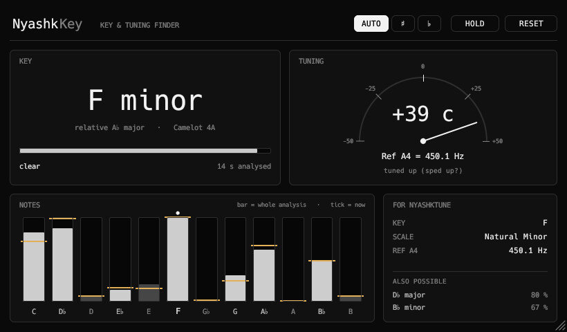

# NyashkKey

Key and tuning finder (VST3, Rust / nih-plug). Put it on a sample, a beat or the master and play: it shows

- the **key** (e.g. F minor), how sure it is, the relative key and the Camelot code, plus the two next best keys;
- the **tuning**: how far the audio is off 440 Hz in cents (a sped-up or slowed-down sample) and the matching **Ref A4**;
- the **notes** that sound (whole analysis and right now), with the scale notes and the tonic marked;
- the values to type into **NyashkTune**: Key, Scale and Ref A4.

The audio passes through untouched. HOLD freezes the result, RESET starts a new analysis. Notes are spelled the
way the found key is written (AUTO) or always with sharps / flats.

How it works: the input is decimated to ~12 kHz, every ~0.17 s an 8192-point FFT is taken, spectral peaks are
refined to a fraction of a bin and collected in a one-cent pitch histogram. The tuning is the circular mean of the
peaks' offsets from the 440 Hz grid; the 12-note profile is read around the tuned note centres and matched
against major / minor key profiles (Temperley).



Part of the Nyashk plugin family, installable with [NyashkLauncher](https://github.com/xslimakx/NyashkLauncher).

## Build

```
cargo xtask bundle -p nyashkkey --release   # target/bundled/NyashkKey.vst3
cargo test --release -p nyashkkey
```
